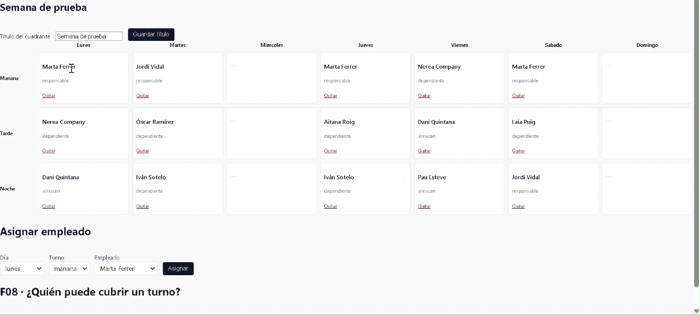
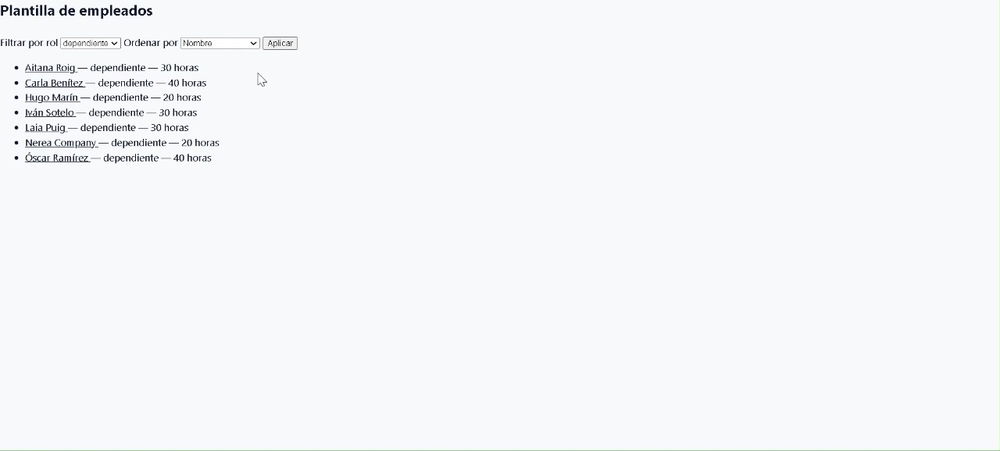
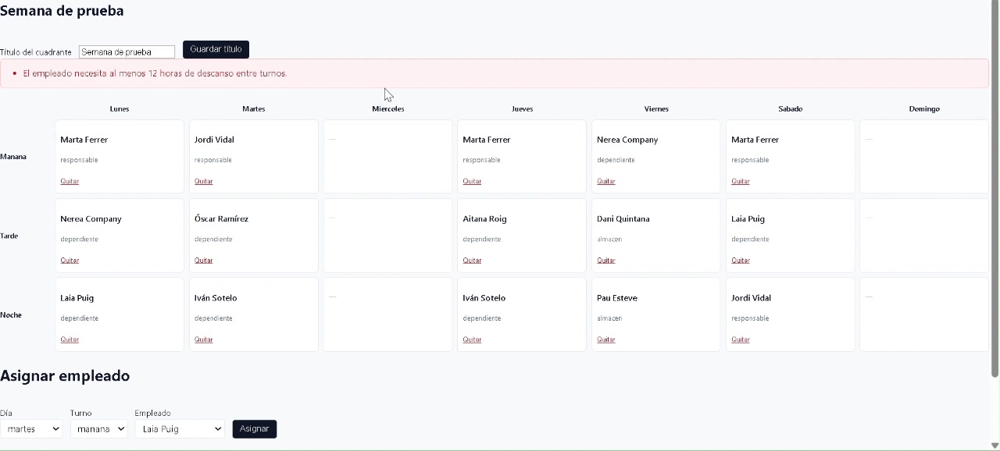
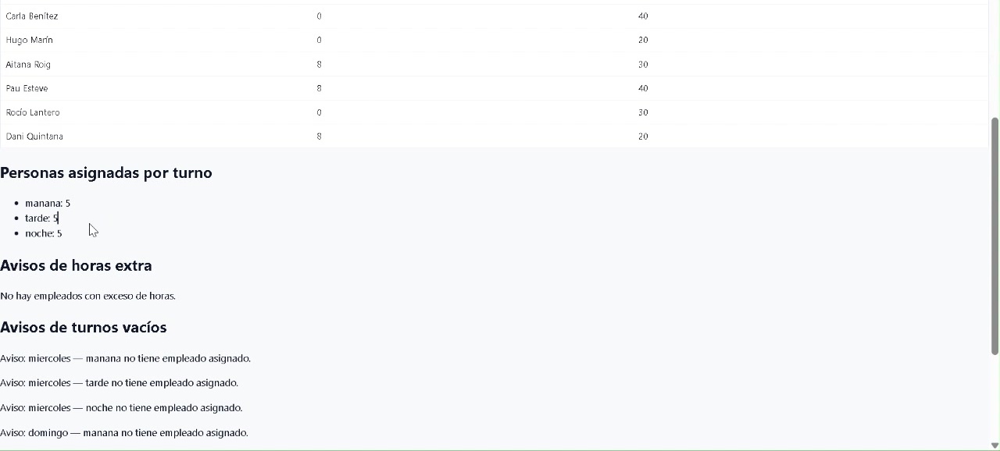
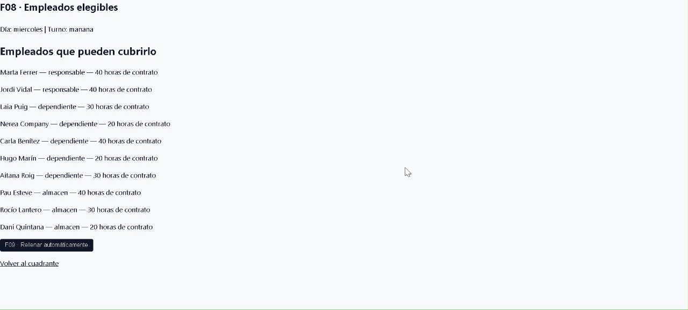

# CuadranteTurnos

Aplicación web desarrollada con **PHP y Laravel** para gestionar la asignación semanal de turnos de trabajo, aplicar reglas de validación y consultar información sobre la cobertura del cuadrante.

Proyecto académico de Desarrollo de Aplicaciones Multiplataforma (DAM).

## Funcionalidades

- Consulta del listado de empleados y sus fichas individuales.
- Visualización de un cuadrante semanal con tres turnos diarios.
- Asignación y eliminación de empleados en los turnos.
- Validaciones para evitar asignaciones incompatibles, incluyendo solapamientos y descansos mínimos.
- Consulta de empleados elegibles para un turno.
- Asignación automática de un empleado disponible.
- Personalización del título del cuadrante.
- Resumen de horas asignadas por empleado, cobertura de turnos y posibles incidencias.

## Capturas de pantalla

### Cuadrante semanal


### Gestión de empleados


### Validación de descansos


### Resumen de turnos


### Empleados elegibles


## Tecnologías utilizadas

- **PHP 8.4** — lógica de la aplicación.
- **Laravel 13** — framework web, rutas, controladores y validaciones.
- **Blade y CSS** — presentación de las interfaces.
- **Laravel Sail y Docker** — entorno de ejecución.
- **PHPUnit** — pruebas automatizadas.
- **Git y GitHub** — control de versiones.

## Organización del proyecto

- `app/Http/Controllers/`: gestión de peticiones de empleados y cuadrantes.
- `app/Http/Requests/`: validación de datos de entrada.
- `app/Rules/`: reglas de validación.
- `app/Services/`: consulta de empleados elegibles.
- `app/Stores/`: almacenamiento y gestión de las asignaciones.
- `resources/views/`: interfaces desarrolladas con Blade.
- `routes/web.php`: rutas de la aplicación.
- `tests/Feature/`: pruebas de funcionalidades.

## Persistencia

El proyecto utiliza almacenamiento basado en sesiones de Laravel para gestionar las asignaciones del cuadrante.

No incorpora una base de datos relacional.

## Ejecución local

Requisitos: Docker con Docker Compose y un entorno de terminal compatible con Laravel Sail.

```bash
docker run --rm -e COMPOSER_PROCESS_TIMEOUT=0 -v "$(pwd):/var/www/html" -w /var/www/html laravelsail/php84-composer:latest composer install

cp .env.example .env

./vendor/bin/sail up -d
./vendor/bin/sail artisan key:generate
```

Abrir `http://localhost` en el navegador.

## Pruebas

El repositorio contiene pruebas automatizadas de las principales funcionalidades, incluyendo la gestión de empleados, asignación de turnos, validaciones y funciones adicionales.

Para ejecutarlas:

```bash
./vendor/bin/sail artisan test
```

## Contexto

Proyecto realizado durante el CFGS de Desarrollo de Aplicaciones Multiplataforma, centrado en la lógica de negocio, validación de reglas, organización del código y pruebas de una aplicación web.

**Autor:** Siro Gascón Ogasawara


Haz un commit en cuanto la página de prueba te responda. Ese es tu punto cero.
